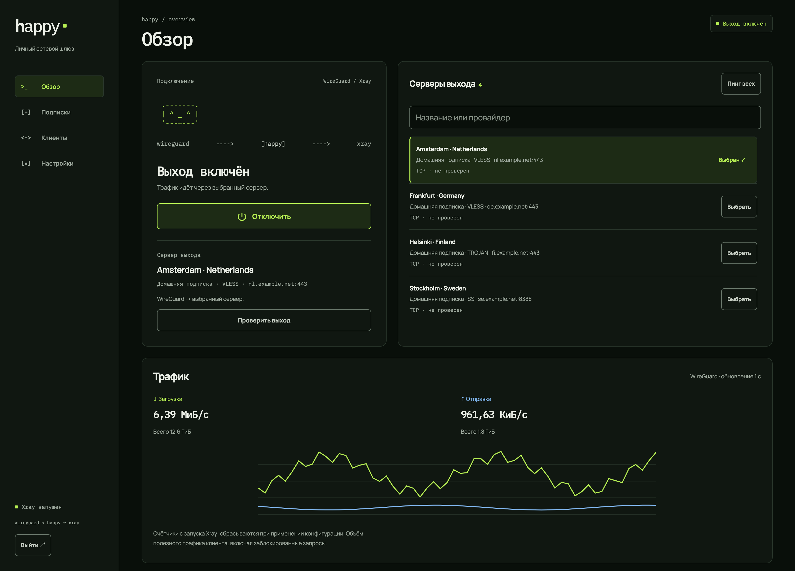

<div align="center">

# happy ▪

### Один шлюз. Твой маршрут.

Личный VPN-шлюз с русской веб-панелью.<br />
Подключай устройства по WireGuard и выбирай выход из подписки провайдера.

[](https://github.com/mleykhner/happy/actions/workflows/check.yml)
[](go.mod)
[](web/package.json)
[](scripts/fetch-xray.sh)
[](compose.yaml)

<br />



<br />

[Быстрый старт](#быстрый-старт) · [Возможности](#возможности) · [Документация](#документация) · [Планы](#планы)

</div>

---

## Как это работает

```text
Телефон / ноутбук / планшет
            │
        WireGuard
            │
          Happy ─── Xray ─── выбранный сервер ─── Интернет
            │
       Веб-панель
```

Happy работает на твоём Linux-сервере. Добавь подписку, выбери узел и создай отдельный WireGuard-конфиг для каждого устройства. Все клиенты используют один выбранный выход. Если выход отключён или выбранный узел исчез из подписки, клиентский трафик блокируется.

Системный WireGuard-интерфейс, TUN, IP forwarding и NAT не требуются. Сеть остальных приложений на сервере продолжает работать через обычное соединение.

## Возможности

<table>
<tr>
<td width="50%" valign="top">

### Подписки и серверы

- Несколько HTTP(S)-подписок: ссылки, Base64 и JSON Xray.
- VLESS, VMess, Trojan и Shadowsocks.
- Ручное обновление и автоматическое обновление раз в сутки.
- Автопроверка интернета каждые 30 секунд, статус соединения и до трёх переподключений при сбое.
- Поиск узлов и проверка доступности TCP-портов.
- Сведения провайдера: трафик, срок действия и объявления.
- Постоянный HWID шлюза для привязки у провайдера.

### Устройства

- До 253 WireGuard-клиентов.
- Отдельные имена, адреса и ключи.
- Скачивание конфигурации и QR-код.
- Отключение, удаление и перевыпуск ключей.

</td>
<td width="50%" valign="top">

### DNS и мониторинг

- DNS через выбранный выход: UDP, TCP, DoH и DoT.
- Кеш, ограничение клиентских подсетей и политика при сбое.
- Автонастройка DNS в WireGuard-конфигах.
- График скорости и счётчики клиентского трафика.
- Проверка выбранного выхода через HTTPS.

### Управление и хранение

- Русская адаптивная панель с тёмной темой.
- Один администратор, сессии и проверка Origin.
- SQLite и постоянный Docker-том для данных.
- Проверка конфигурации Xray, откат и watchdog.
- Docker Compose, Ubuntu и NixOS.

</td>
</tr>
</table>

### Поддерживаемые подключения

| Протоколы | Транспорты | Защита |
|---|---|---|
| VLESS, VMess, Trojan, Shadowsocks | TCP / RAW, WebSocket, gRPC, XHTTP, HTTPUpgrade | TLS, REALITY; зависит от протокола |

XHTTP поддерживает `extra`, XMUX и `downloadSettings`. Поддерживаются также одиночные и массивные JSON-конфигурации Xray с балансировщиками. [Контейнеры подписок INCY](docs/subscription-formats.md) распознаются с учетом текущих протоколов Happy. Неизвестные протоколы пропускаются; повреждённая поддерживаемая запись приводит к ошибке обновления с сохранением последней корректной версии. Hysteria2 пока [запланирован](docs/hysteria2-plan.md).

## Быстрый старт

Нужны Linux-сервер, Docker Engine и Docker Compose. Образ собирается для **amd64** и **arm64**.

### 1. Подготовь репозиторий и пароль

```sh
git clone https://github.com/mleykhner/happy.git
cd happy
mkdir -p secrets
chmod 700 secrets
openssl rand -base64 24 > secrets/admin-password
chmod 600 secrets/admin-password
```

Посмотри и сохрани сгенерированный пароль:

```sh
cat secrets/admin-password
```

На Linux дай пользователю контейнера доступ к файлу:

```sh
sudo chown 10001:10001 secrets/admin-password
```

Можно записать свой пароль длиной 12–72 байта вместо сгенерированного. Файл пароля исключён из git.

### 2. Запусти Happy

```sh
docker compose pull
docker compose up -d --no-build
```

Панель: **[http://localhost:8080](http://localhost:8080)** на машине с Docker. С другого компьютера подключись через SSH-туннель:

```sh
ssh -L 8080:127.0.0.1:8080 user@SERVER_IP
```

После этого открой тот же адрес в своём браузере. Для публичного HTTPS-доступа или прямого доступа по IP см. [установку и reverse proxy](docs/installation.md#docker).

### 3. Подключи устройства

1. Войди с паролем из `secrets/admin-password`.
2. В **Настройках** укажи внешний IP или домен сервера.
3. В **Подписках** добавь ссылку провайдера и нажми **Обновить**.
4. В **Обзоре** выбери сервер выхода.
5. В **Клиентах** создай устройство и импортируй конфиг или QR в WireGuard.
6. Открой **UDP 51820** в firewall сервера и у хостинга.

> Данные сохраняются в Docker-томе `happy-data`. Не удаляй том при обновлении: в нём подписки, HWID и ключи устройств.

<details>
<summary><strong>Обновление, локальная сборка и логи</strong></summary>

Обновить готовый образ:

```sh
docker compose pull
docker compose up -d --no-build
```

Собрать текущие исходники:

```sh
docker compose up -d --build
```

Посмотреть логи:

```sh
docker compose logs -f --tail=100 happy
```

При ошибках подписки см. [диагностику](docs/troubleshooting.md).

</details>

## Другие способы установки

| Способ | Что входит | Инструкция |
|---|---|---|
| Docker Compose | Happy + Xray, постоянный том, непривилегированный контейнер | [Docker](docs/installation.md#docker) |
| Ubuntu 24.04 | `.deb` из исходников, Xray, systemd-сервис | [Ubuntu](docs/installation.md#ubuntu-2404) |
| Nix / NixOS | Flake-пакет и модуль с systemd, firewall и необязательным HTTPS | [NixOS](docs/installation.md#nix-и-nixos) |

## Документация

| Руководство | Содержание |
|---|---|
| [Установка](docs/installation.md) | Docker, Ubuntu, NixOS, HTTPS, порты и обновления |
| [Настройка](docs/configuration.md) | Переменные окружения, DNS, метрики, подписки и ограничения |
| [Диагностика](docs/troubleshooting.md) | Origin, ошибки провайдера, HWID и импорт узлов |
| [Форматы подписок](docs/subscription-formats.md) | JSON Xray, Base64, смешанные контейнеры и совместимость с INCY |
| [Разработка](docs/development.md) | Локальная сборка, тесты, зависимости и CI |
| [Интеграционные тесты](integration/README.md) | Проверка WireGuard и реального маршрута через Xray |

## Границы проекта

Happy — личный шлюз с одним администратором и одним выбранным выходом. Автопереключение между серверами подписок и Clash YAML не поддерживаются; внутри JSON-конфигурации Xray может работать балансировщик провайдера. Клиентский IPv6 блокируется; доступ клиентов к частным и служебным сетям ограничен.

Подписки и ключи хранятся в SQLite без дополнительного шифрования на диске. Защити каталог данных и резервные копии; для резервирования останови сервис и скопируй данные целиком. Подробности — в [настройке и ограничениях](docs/configuration.md#ограничения-и-хранение-данных).

## Планы

- [ ] [Hysteria2](docs/hysteria2-plan.md) — официальный клиент рядом с Xray с сохранением проверки `pinSHA256`.
- [ ] [Режим LAN-шлюза](docs/lan-gateway-plan.md) — подключение устройств локальной сети без VPN-клиента.

---

<div align="center">

**wireguard → happy → xray**

<sub>Один сервер. Несколько устройств. Один выбранный выход.</sub>

</div>
